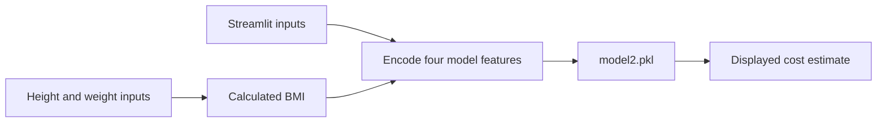

# Medical Insurance Price Prediction

**A Streamlit demonstration of serving a saved prediction model through a simple form.**

The app turns age, sex, BMI, and smoking status into an estimated insurance cost. It illustrates the connection between user inputs, feature encoding, a serialized model, and an immediately visible prediction.

## What it includes

- A form for age, sex, BMI, and smoking status.
- A saved model loaded from `model2.pkl` with Joblib.
- Sidebar calculations for BMI, BMR, activity-adjusted energy expenditure, and related estimates.
- A prediction result displayed in rupees.

## Architecture



## Run locally

Download the repository ZIP, extract it, and open a terminal in the extracted directory. Use a Python environment compatible with the saved model.

```bash
python -m pip install streamlit pandas joblib scikit-learn
python -m streamlit run app.py
```

There is no pinned dependency manifest in this repository. The packages above cover the app imports and typical scikit-learn model loading; the training environment may require specific compatible versions.

## Example

Enter an age and smoking status, adjust the sidebar height and weight, then select **Predict Insurance Cost**. The current implementation uses the **sidebar-calculated BMI** for prediction: it overwrites the BMI value entered in the main form.

## Repository guide

| File | Purpose |
|---|---|
| [app.py](app.py) | Streamlit interface, feature encoding, and inference |
| `model2.pkl` | Saved model artifact |
| `Medical_insurance.csv` | Included dataset |

## Current limitations

The repository does not include a reproducible training script or documented validation results. Currency is a display label in the app; the dataset's units and the model's calibration should be checked before interpreting predictions. This is an educational model-serving example, not an insurer quote or a medical assessment.

Only load model artifacts from a trusted source, because pickle-based formats can execute code when deserialized.
